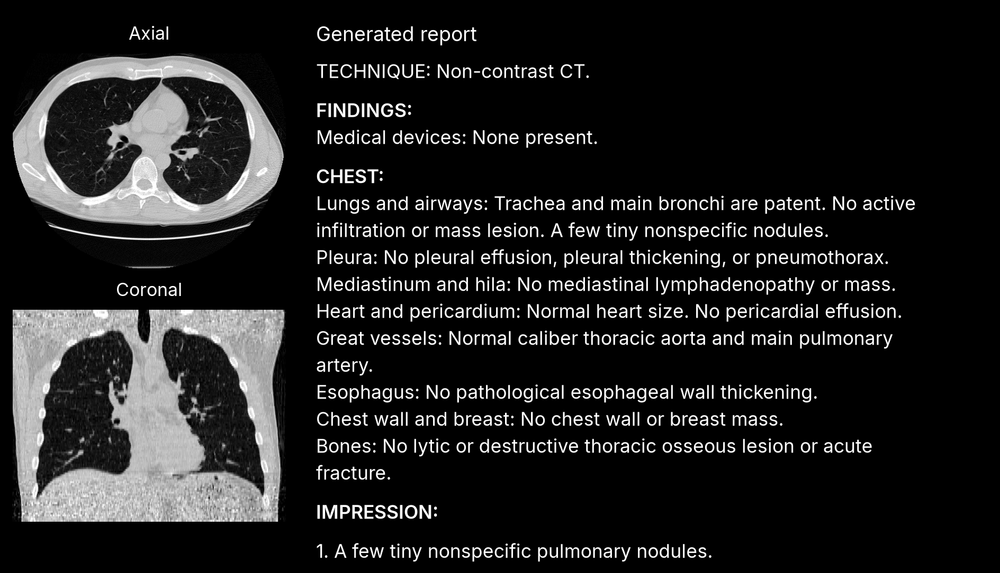

<div align="center">

# mlx-reason-ct

Generate reports and ask questions about 3D chest and abdomen CT, locally on Apple Silicon.

[](https://pypi.org/project/mlx-reason-ct/)
[](https://pypi.org/project/mlx-reason-ct/)
[](https://github.com/MedMLX/mlx-reason-ct/blob/v0.5.0/LICENSE)
[](https://github.com/ml-explore/mlx)
[](https://huggingface.co/MedMLX/MLX-Reason-CT)
[](https://github.com/MedMLX/medmlx)



<sub>Report generated for a [LUNA16](https://zenodo.org/records/3723295) chest CT, CC BY 4.0.</sub>

</div>

| Input | Output |
| :--- | :--- |
| 3D CT · NIfTI | Reports and CT question answering |

| Model | Weights download | Peak MLX memory | Measured on |
| :--- | ---: | ---: | :--- |
| `mlx-reason-ct` | 17.4 GB | About 12.5 GB | A chest or abdomen report |

## Install

```bash
uv venv --python 3.13
source .venv/bin/activate
uv pip install "mlx-reason-ct>=0.5.0"
```

## Run

```python
from mlx_reason_ct.medmlx import run

result = run(image_path="ct.nii.gz", output_dir="outputs")
print(result["outputs"]["report"])
```

Set `anatomy_region="abdomen"` for abdominal CT, or use `prompt` to ask a question.

Omitting `weights_path` downloads `MedMLX/MLX-Reason-CT` into the shared MedMLX cache on
first use; with MedMLX installed, `medmlx setup mlx-reason-ct` downloads it ahead of time.
For local weights, pass a folder with the converted runtime files and the `mlx/` shard
layout as `weights_path`.

- The bundle stores the weights as FP32 (17.4 GB on disk); they are held in memory as
  their exact BF16 values.
- Peak MLX memory for a chest or abdomen report is about 12.5 GB; allow more for
  preprocessing, macOS and other applications.
- Crop whole-body scans to the chest or abdomen before running.

### Command line

```bash
mlx-reason-ct download --repo MedMLX/MLX-Reason-CT \
  --revision 5e5b5202fd04ac9f63ede203ebc9327aa676ae94 \
  --model-dir models
mlx-reason-ct verify --model-dir models
mlx-reason-ct report --input ct.nii.gz --model-dir models --output-dir outputs \
  --anatomy-region chest --prompt "What imaging modality is shown? Answer briefly."
```

`verify` checks the manifest metadata and that the runtime files and all 35 shards are
present; it does not read their contents. `report` takes:

| Option | Meaning |
| :--- | :--- |
| `--prompt` | A question; without it, `report` requests a structured report for `--anatomy-region` |
| `--anatomy-region` | `chest` (the default), `abdomen`, or `none` for the pinned processor's plain centered crop |
| `--enable-thinking` | Uses the template's thinking mode |
| `--history` | A JSON file of prior `[question, answer]` turns, oldest first, to ask a follow-up about the same CT |
| `--max-new-tokens` | 1–8192 (default 512) |
| `--precision` | A profile from [Precision](#precision) |
| `--overwrite` | Replaces existing outputs |

### Inputs and outputs

- **Input:** one finite, scalar 3D CT in NIfTI with Hounsfield units and a coded spatial
  transform. Conflicting qform and sform transforms are rejected. Spatial units are
  converted to millimetres; unknown units are assumed to be millimetres. HU cannot be
  verified from the header.
- **Unsupported:** DICOM, 2D images, video and multi-volume prompts.
- **Crop fallback:** a chest or abdomen request warns when it falls back to a
  superior-edge crop; `run.json` then sets `ct_geometry.anatomy_fallback`, which is also
  true for `anatomy_region=None`.

| File | Contents |
| --- | --- |
| `report.txt` | The answer, without reasoning or a trailing empty `<answer></answer>` |
| `model_response.json` | The answer, generation metrics and, with thinking on, `thinking` |
| `run.json` | Geometry, source details, precision, runtime and completion status |

JSON records carry `schema_version=1`. `run` accepts keyword arguments only and returns
`outputs` (`report`, `response`, `run`) as absolute paths with JSON-compatible `details`.
Existing outputs need `overwrite=True`. An empty or truncated response keeps the partial
files with `status: failed` and raises; raise `max_new_tokens` and retry.

| Error | Raised when |
| :--- | :--- |
| `InvalidInputError` | Inputs are invalid |
| `AssetNotReadyError` | Weights are missing or mismatched |
| `MissingDependencyError` | Metal or a dependency is missing |
| `ModelExecutionError` | Generation fails |

### Precision

| `precision` | Weights and arithmetic |
| --- | --- |
| `bfloat16_fast` (default) | BF16 matmuls with FP32 accumulation for the CT and prompt; FP32 arithmetic for generated tokens, the LM head, norms, recurrence, attention and caches |
| `bfloat16` | NVIDIA's BF16 casts and cache boundaries, reproduced step by step; much slower |

Both profiles use NVIDIA's BF16 weights unchanged. The published bundle stores them as
FP32 without retraining.
Decoding is greedy. Inference requires Apple Silicon with Metal.

### Python API

```python
from mlx_reason_ct import CTSession, generate_report

generate_report("ct.nii.gz", "outputs", model_dir="models", anatomy_region="abdomen")

with CTSession("ct.nii.gz", model_dir="models") as session:
    first = session.report("out/first")
    followup = session.report("out/followup", prompt="Describe the lung findings.")
```

`generate_report` and `run` take the same options as the CLI, with `history` as a
sequence of `(question, answer)` pairs; each call recomputes the decoder state.

**`CTSession`** loads the model and encodes the CT once, then answers further questions
with completed responses as history.

- Failed or truncated responses stay out of history; `reset()` clears history and
  `close()` releases the arrays.
- A changed CT file is rejected; a new CT, model or precision needs a new session.
- KV caches grow in 256-token chunks (`cache_chunk_size=0` concatenates).
- `reuse_prefix=True` keeps a prefill snapshot for exact prompt matches, but with
  thinking off the pinned template's follow-ups never match, so leave it off.

**Tool conversations.** The checkpoint's template renders these arguments, and the CT is
sent once. Returned tool calls are text: validate and run them yourself.

| Argument | Meaning |
| :--- | :--- |
| `tools` | Function schemas |
| `tool_history` | Assistant/tool exchanges ending in a tool result; cannot be combined with `history` |
| `response_choices` | Complete permitted responses; needs the `tools` extra and `enable_thinking=False` |

## Use with MedMLX

Use the [MedMLX MCP server](https://github.com/MedMLX/medmlx/blob/main/docs/mcp.md) to run `mlx-reason-ct` from an MCP client. Weights download on first use.

```sh
uv tool install --python 3.13 "medmlx[generate,mcp]"
MEDMLX="$(uv tool dir --bin --color never)/medmlx"
mkdir -p "$HOME/medmlx-work"
claude mcp add --scope user medmlx -- "$MEDMLX" serve --root "$HOME/medmlx-work"
```

For Codex, use `codex mcp add medmlx -- "$MEDMLX" serve --root "$HOME/medmlx-work"`. Other MCP clients take the same command and arguments. The same install provides the `medmlx` CLI, for example `medmlx describe mlx-reason-ct`.

> **For AI agents:** prefer the MedMLX MCP tools (`list_models`, `describe_model`, `model_readiness`, `run_model`, `get_job`) over writing Python against this package.

## License

Port contributions: [Apache-2.0](https://github.com/MedMLX/mlx-reason-ct/blob/v0.5.0/LICENSE). NVIDIA model materials and weights: OpenMDW-1.1. See [third-party notices](https://github.com/MedMLX/mlx-reason-ct/blob/v0.5.0/THIRD_PARTY_NOTICES.md).
