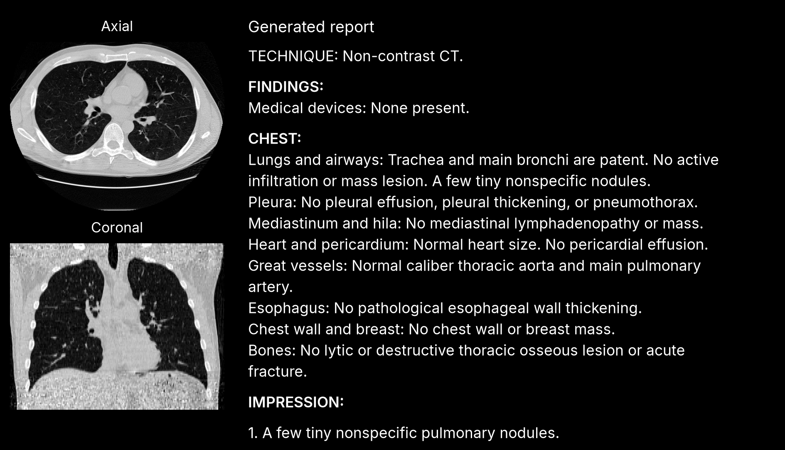

<div align="center">

# mlx-reason-ct

Generate reports and ask questions about 3D chest and abdomen CT, locally on Apple Silicon.

[](https://pypi.org/project/mlx-reason-ct/)
[](https://pypi.org/project/mlx-reason-ct/)
[](https://github.com/MedMLX/mlx-reason-ct/blob/v0.8.0/LICENSE)
[](https://github.com/ml-explore/mlx)
[](https://huggingface.co/MedMLX/MLX-Reason-CT)
[](https://github.com/MedMLX/medmlx)



<sub>Report generated for a [LUNA16](https://zenodo.org/records/3723295) chest CT, CC BY 4.0.</sub>

</div>

| Input | Output |
| :--- | :--- |
| 3D CT · NIfTI | Reports and CT question answering |

| Model | Weights download | Peak MLX memory | Measured on |
| :--- | ---: | ---: | :--- |
| `mlx-reason-ct` | 17.4 GB | 12.5 GB | A chest or abdomen report |

## Install

```bash
uv venv --python 3.13
source .venv/bin/activate
uv pip install "mlx-reason-ct>=0.8.0"
```

## Run

```python
from mlx_reason_ct import run

result = run(image_path="ct.nii.gz", output_dir="outputs")
print(result["details"]["report"])
```

Set `anatomy_region="abdomen"` for abdominal CT, or use `prompt` to ask a question.

Weights download from `MedMLX/MLX-Reason-CT` on first use; `medmlx setup mlx-reason-ct`
downloads them ahead of time. For local weights, pass a folder with the converted
runtime files and the `mlx/` shard layout as `weights_path`.

- The bundle stores the weights as FP32 (17.4 GB on disk); they are held in memory as
  their exact BF16 values.
- Allow memory beyond the MLX peak for preprocessing, macOS and other applications.
- Crop whole-body scans to the chest or abdomen before running.

### Command line

```bash
mlx-reason-ct download --repo MedMLX/MLX-Reason-CT \
  --revision 5e5b5202fd04ac9f63ede203ebc9327aa676ae94 \
  --model-dir models
mlx-reason-ct verify --model-dir models
mlx-reason-ct report --input ct.nii.gz --model-dir models --output-dir outputs \
  --anatomy-region chest --prompt "What imaging modality is shown? Answer briefly."
mlx-reason-ct chat --input ct.nii.gz --model-dir models --output-dir conversation
```

`verify` checks the manifest metadata and that the runtime files and all 35 shards are
present; it does not read their contents. `chat` keeps the model loaded and answers each
line you type about the same CT, printing the answer as it is generated and passing the
earlier turns as history; turn *N* is written to `turn-NNN` under the output folder.
`report` prints the `run.json` record and writes the answer to `report.txt` in the output
folder; it takes:

| Option | Meaning |
| :--- | :--- |
| `--prompt` | A question; without it, `report` requests a structured report for `--anatomy-region` |
| `--anatomy-region` | `chest` (the default), `abdomen`, or `none` for the pinned processor's plain centered crop |
| `--enable-thinking` | Uses the template's thinking mode |
| `--history` | A JSON file of prior `[question, answer]` turns, oldest first, to ask a follow-up about the same CT |
| `--response-choice` | A complete permitted answer; repeat it to let the model choose among several |
| `--tools` | A JSON file of function schemas; see [Tool conversations](#tool-conversations) |
| `--tool-choice required` | Restricts the answer to one call of a tool from `--tools` |
| `--tool-history` | A JSON file of assistant and tool turns, ending in a tool result |
| `--max-new-tokens` | 1–8192 (default 1024) |
| `--precision` | A profile from [Precision](#precision) |
| `--overwrite` | Replaces existing outputs |

`chat` takes `--anatomy-region`, `--enable-thinking`, `--max-new-tokens`, `--precision`,
`--overwrite` and `--prefill-reuse` (see [Several questions about one CT](#several-questions-about-one-ct)).

### Inputs and outputs

- **Input:** one finite, scalar 3D CT in NIfTI with Hounsfield units and a coded spatial
  transform. Conflicting qform and sform transforms are rejected. Spatial units are
  converted to millimeters; unknown units are assumed to be millimeters. HU cannot be
  verified from the header.
- **Unsupported:** DICOM, 2D images, video and multi-volume prompts.
- **Crop fallback:** a chest or abdomen request warns when it falls back to a
  superior-edge crop; `run.json` then sets `ct_geometry.anatomy_fallback`, which is also
  true for `anatomy_region=None`.

| Output role | File | Contents |
| --- | --- | --- |
| `report` | `report.txt` | The answer, without reasoning or a trailing empty `<answer></answer>` |
| `response` | `model_response.json` | The answer, generation metrics and, when present, `thinking`, `labels` and `tool_calls` |
| `metadata` | `run.json` | Geometry, source details, precision, runtime and completion status |

JSON records carry `schema_version=1`. `run` accepts keyword arguments only
and returns `outputs` by role as absolute paths, an `artifacts` entry for each, and the
`run.json` record as `details`, with the answer fields of `model_response.json` added:

| `details[...]` | Contents |
| :--- | :--- |
| `report` | The text of `report.txt` |
| `thinking` | The reasoning, with `enable_thinking=True` |
| `labels` | The finding labels a report or analysis ends with (`<answer> Lung nodule, Emphysema </answer>`), as a list |
| `tool_calls` | With `tools`: the requested calls as `{"name", "arguments"}`, empty for a prose answer |

Existing outputs need `overwrite=True`. An empty or truncated response keeps the partial
files with `status: failed` and raises; raise `max_new_tokens` and retry.

| Error | Raised when |
| :--- | :--- |
| `InvalidInputError` | Inputs are invalid |
| `AssetNotReadyError` | Weights are missing or mismatched |
| `MissingDependencyError` | Metal or a dependency is missing |
| `ModelExecutionError` | Generation fails |

### Precision

| `precision` | Weights and arithmetic |
| --- | --- |
| `fast-bf16` (default) | BF16 matmuls with FP32 accumulation for the CT and prompt; FP32 arithmetic for generated tokens, the LM head, norms, recurrence, attention and caches |
| `source-bf16` | NVIDIA's BF16 casts and cache boundaries, reproduced step by step; much slower |

Both profiles use NVIDIA's BF16 weights unchanged. The published bundle stores them as
FP32 without retraining.
Decoding is greedy.

### Several questions about one CT

```python
from mlx_reason_ct import load_model

with load_model(image_path="ct.nii.gz", anatomy_region="abdomen") as session:
    first = session.run(output_dir="out/first")
    question = "Describe the liver findings."
    followup = session.run(
        output_dir="out/followup",
        prompt=question,
        history=[("Write a structured abdominal CT report.", first["details"]["report"])],
    )
```

`load_model` loads the model and encodes the CT on the first call, then releases the
visual weights, so a session serves one CT at the one-shot peak memory. Its
`run` takes the per-call options (`prompt`, `history`, `tools`, `tool_choice`,
`tool_history`, `response_choices`, `enable_thinking`, `max_new_tokens`, `overwrite`);
`history` is a sequence of already-answered `(question, answer)` pairs, oldest first.

- A changed CT file is rejected; a new CT, model or precision needs a new session.
- `on_text=callback` on a session's `run` streams the response: the callback receives each
  new piece of text as it is generated. The pieces are the raw response, before the
  cleanup that gives `details["report"]`, so with thinking enabled they include the
  reasoning and `</think>`.
- After its first call, a session decodes only the end of each prompt and reuses the
  decoder state of the CT tokens before it, so later questions return much sooner.
  `prefill_reuse="exact"` (the default) reproduces the logits of a whole prefill.
  `prefill_reuse="fast"` decodes less again, with logits that differ at rounding level:
  use it for yes/no questions and tool calls, where it changed no answer in testing,
  rather than for free-text reports, whose wording can change. The
  [technical notes](https://github.com/MedMLX/mlx-reason-ct/blob/main/docs/technical.md#sessions)
  give the measurements. Changing `tools` between calls rebuilds that state once.
- KV caches grow in 256-token chunks (`cache_chunk_size=0` concatenates).

**Choosing among fixed answers.** `response_choices` restricts the answer to one of the
strings you pass (install the `tools` extra: `uv pip install "mlx-reason-ct[tools]"`). The
model still chooses with its own logits, and the result reports how it weighed them:

```python
answer = session.run(
    output_dir="out/effusion",
    prompt="Is a pleural effusion present in this CT? Answer only Yes or No.",
    response_choices=["Yes", "No"],
)
answer["details"]["report"]  # "No"
answer["details"]["generation"]["choice_probabilities"]  # {"Yes": 0.0004, "No": 0.9996}
```

`choice_probabilities` is present when the model's first decision settles the choice, as it
does for `Yes`/`No`; `choice_probability`, the probability of the selected choice, always is.

### Tool conversations

Declare your tools as function schemas, let the model pick the call, run it yourself and
hand the result back. This package never executes a tool.

```python
import json

from mlx_reason_ct import load_model

tools = [
    {
        "type": "function",
        "function": {
            "name": "segment_organ",
            "description": "Segment one organ and measure its volume in milliliters.",
            "parameters": {
                "type": "object",
                "properties": {"organ": {"type": "string", "enum": ["liver", "spleen"]}},
                "required": ["organ"],
            },
        },
    },
    {
        "type": "function",
        "function": {
            "name": "measure_liver_lesions",
            "description": "Detect focal liver lesions and measure their largest diameter.",
            "parameters": {"type": "object", "properties": {}},
        },
    },
]
question = "What is the volume of the liver?"

with load_model(image_path="ct.nii.gz", anatomy_region="abdomen") as session:
    request = session.run(
        output_dir="out/request", prompt=question, tools=tools, tool_choice="required"
    )
    call = request["details"]["tool_calls"][0]
    # {"name": "segment_organ", "arguments": {"organ": "liver"}}
    result = my_tools[call["name"]](**call["arguments"])  # your code runs the tool
    answer = session.run(
        output_dir="out/answer",
        prompt=question,
        tools=tools,
        tool_history=[
            {"role": "assistant", "content": request["details"]["report"]},
            {"role": "tool", "content": json.dumps(result)},
        ],
    )
print(answer["details"]["report"])  # "The liver volume is 1452.9 ml."
```

| Argument | Meaning |
| :--- | :--- |
| `tools` | Function schemas, rendered by the checkpoint's own chat template |
| `tool_choice` | `"required"` restricts the answer to one call of a declared tool. Required parameters need an `enum` (or the boolean type); optional parameters are left out |
| `response_choices` | Complete permitted responses, for calls `tool_choice` cannot enumerate, such as one call per candidate a tool returned. `mlx_reason_ct.tool_calls.render_tool_call(name, arguments)` writes a call in the checkpoint's syntax |
| `tool_history` | Alternating assistant and tool turns, each `{"role", "content"}`, ending in a tool result; cannot be combined with `history` |

- The checkpoint answers in prose unless a call is required, so use `tool_choice` or
  `response_choices` for the turn that should request a tool. Both need the `tools` extra
  and `enable_thinking=False`.
- `details["tool_calls"]` is checked against your schemas: the tool and its parameters are
  declared, required ones are present, and values match their `type` and `enum`. Markup
  that fails leaves the list empty and sets `details["tool_call_error"]`.
- The model picks the right tool most reliably when the question names what the tool
  measures ("What is the volume of the spleen?" rather than "Is the spleen enlarged?") and
  when only one tool of a kind is declared: of two lesion detectors, the one declared first
  also takes questions meant for the other. `choice_probability` does not reliably flag a
  wrong call. The
  [technical notes](https://github.com/MedMLX/mlx-reason-ct/blob/main/docs/technical.md#answers-against-ground-truth)
  have the counts.
- Leave thinking off in the turn that reads a tool result, and show the tool's own
  numbers next to the answer: the model can restate a measurement in words, such as
  "moderate-sized", in place of the value.

## Use with MedMLX

Use the [MedMLX MCP server](https://github.com/MedMLX/medmlx/blob/main/docs/mcp.md) to run `mlx-reason-ct` from an MCP client. Weights download on first use.

```sh
uv tool install --python 3.13 "medmlx[generate,mcp]"
MEDMLX="$(uv tool dir --bin --color never)/medmlx"
mkdir -p "$HOME/medmlx-work"
claude mcp add --scope user medmlx -- "$MEDMLX" serve --root "$HOME/medmlx-work"
```

For Codex, use `codex mcp add medmlx -- "$MEDMLX" serve --root "$HOME/medmlx-work"`. Other MCP clients take the same command and arguments. The same install provides the `medmlx` CLI, for example `medmlx describe mlx-reason-ct`.

> **For AI agents:** prefer the MedMLX MCP tools (`list_models`, `describe_model`, `model_readiness`, `run_model`, `get_job`) over writing Python against this package.

## License

Port contributions: [Apache-2.0](https://github.com/MedMLX/mlx-reason-ct/blob/v0.8.0/LICENSE). NVIDIA model materials and weights: OpenMDW-1.1. See [third-party notices](https://github.com/MedMLX/mlx-reason-ct/blob/v0.8.0/THIRD_PARTY_NOTICES.md).
